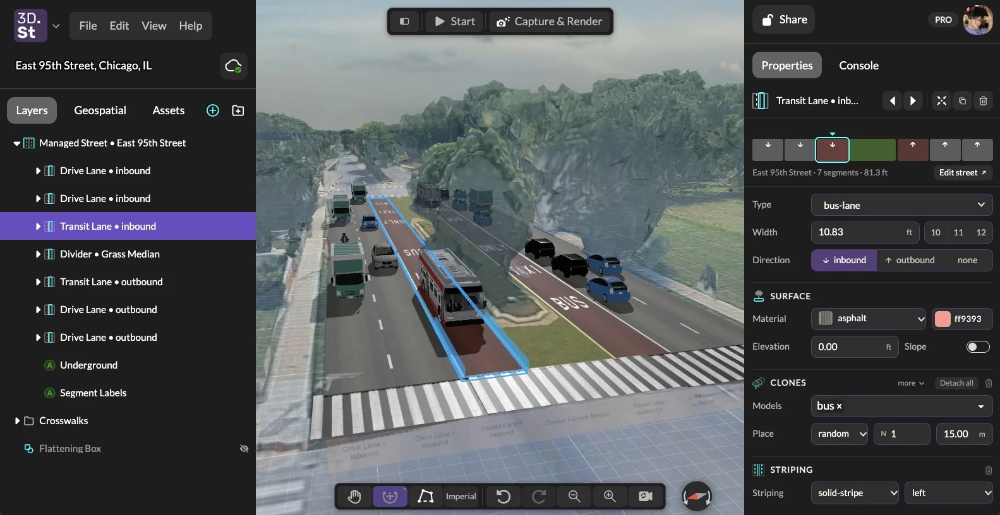
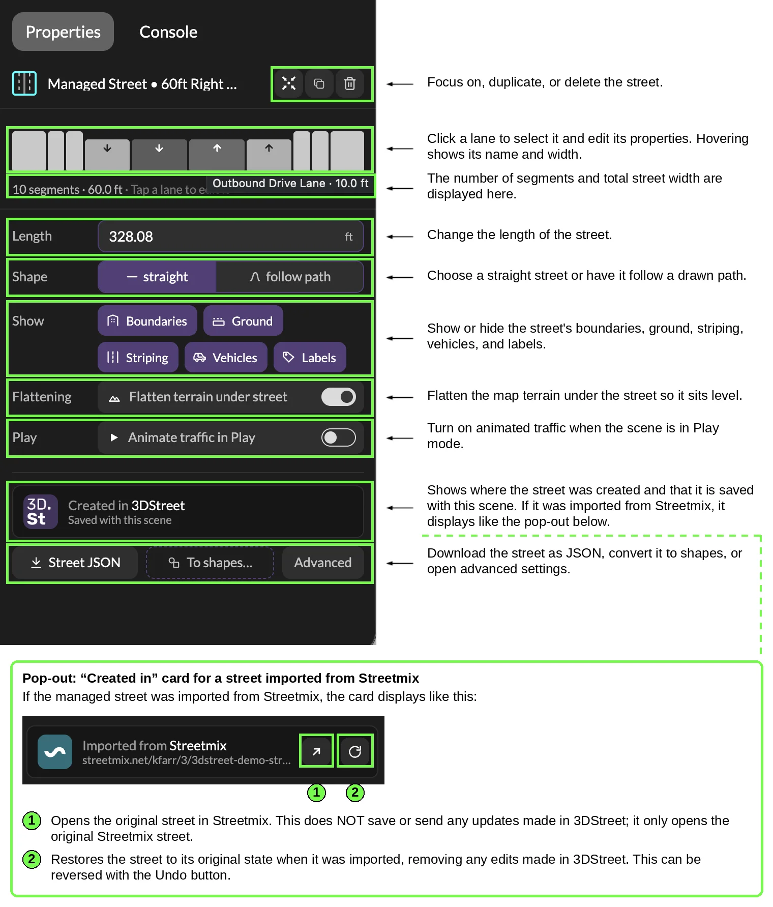
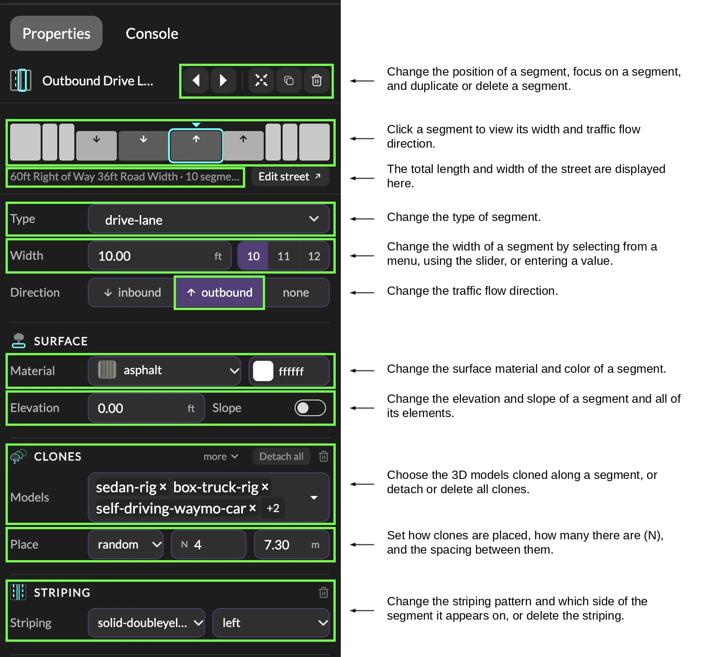
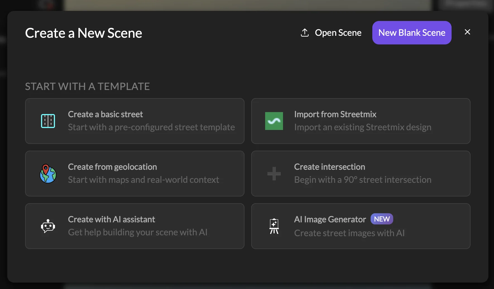
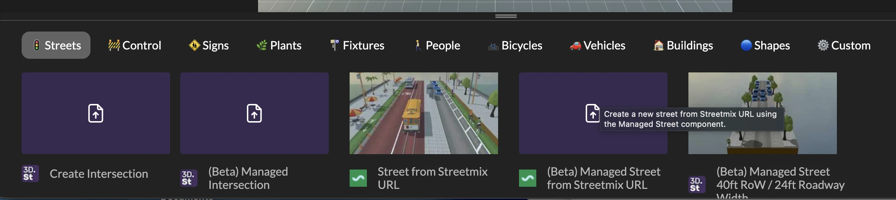

# Managed Street Is Here: Design Streets Directly in 3DStreet

Today we're taking **Managed Street** out of beta and making it the way every street is generated in 3DStreet. Whether you start from a template, import from Streetmix, or ask the AI assistant to build one, you now get a street you can actually edit: change lane types, widths, street length, directions, paint striping and stencils, every car and tree, and more right inside the 3DStreet editor.

This is the biggest change to how 3DStreet works since we started, and it's been a long road to get here.

 <i>
**East 95th Street in Chicago as a Managed Street. Click the inbound bus lane and its type, width, direction, surface, and buses are all editable right in the Properties panel.**</i>

<!-- truncate -->

## Why Managed Street?

3DStreet started in 2017 as "Streetmix3D," a small 3D mod for [Streetmix](https://streetmix.net) so local advocates in San Francisco could show their neighbors what a safer street would actually look like. Streetmix is fantastic at what it does: you can sketch a street cross-section in a couple of minutes, and widths scale proportionally as you drag segments around. 3DStreet grew up as the middle ground between that kind of quick 2D sketch and the very deep end of CAD software.

But there was always a catch. When you imported a Streetmix street into 3DStreet, it arrived as a pile of separate 3D objects. They looked like lanes, but you couldn't edit them as lanes. Want a wider bike lane? Back to Streetmix, re-import, and redo whatever you'd changed in 3DStreet.

We also heard the same request over and over from you: *let me just edit the street in 3DStreet.*

So we started from scratch. Managed Street is a new procedural street system where the street itself is the thing you edit. 3DStreet keeps track of each segment's type, width, direction, surface, and the objects along it, and regenerates the 3D scene whenever you make a change. If you've been following along, you've seen pieces of this land in beta over the past year, including the [major reliability push](/blog/2026/06/22/product-update-asset-uploads-video-to-splat-and-bollard-buddy-ios#major-reliability-push-and-managed-street-leaving-beta) this summer where we compared a whole library of legacy Streetmix imports side by side with their managed equivalents until they matched.

## What's New

### Build and edit streets right in 3DStreet

You no longer need Streetmix to make a street. Start with a template, set the length and width (in feet or meters), and change anything you want. Everything along the street (ground materials, lane striping, stencils, vehicles, people, trees, lamps) adjusts to fit, so no more oddly stretched objects or textures when you change width and length.

Streetmix import still works, and now it imports *into* a Managed Street, so you get the same editing tools whether you started in Streetmix or not. Imported streets keep a link back to the original design: one button opens it in Streetmix, and another reloads the street to how it looked when you imported it.

### A street overview you can click

 <i>
**Select a managed street and the Properties panel shows the whole cross-section at a glance.**</i>

Select a street and the Properties panel shows a simple 2D strip of the whole cross-section: every segment's width, color, direction of travel, and elevation. Hover a lane to see its name and width, and click it to start editing. From the same panel you can:

* **Set the length**, and choose whether the street runs **straight or follows a path** you've drawn.
* **Show or hide whole groups at once.** Boundaries (buildings, fences, waterfronts), Ground, Striping, Vehicles, and Labels each have a single toggle, so there's no more digging through the Layers panel to hide every car one at a time.
* **Flatten the terrain under the street.** On a geospatial scene, a managed street now flattens the 3D map underneath it automatically, fit to the street's footprint. No separate flattening shape to add and line up. You can turn it off with the "Flatten terrain under street" switch, or from **Flattening objects** in the Geospatial tab.
* **Animate traffic in Play mode.** Flip one switch and cars, bikes, and buses drive along their lanes when you press Play. No AI tokens required.
* **Export Street JSON** to save or share the street definition, or use **To shapes…** to turn the street into plain geometry when you need full manual control.

### Edit every lane

 <i>
**Every segment has its own editor: type, width, direction, surface, elevation, clones, and striping.**</i>

Click any lane, whether on the strip or right in the 3D viewport, and you get a full lane editor:

* **Type.** Turn a parking lane into a bike lane, or a drive lane into a bus lane. Striping updates to match its neighbors automatically, so two opposing drive lanes get their double yellow without you having to add it.
* **Width.** Type an exact value, drag the slider, or pick from common engineering widths for that segment type (10, 11, or 12 ft for a drive lane, for example), in feet or meters.
* **Direction.** Inbound, outbound, or none, and the vehicles and stencils turn around with it.
* **Move left or right.** Use the arrow buttons at the top of the panel to swap a lane with its neighbor. The 3D scene and the 2D strip both update instantly.
* **Surface, elevation, and slope.** Change the material and color, raise a segment to curb height, or tilt it between two elevations.
* **Clones.** Choose which 3D models line the segment, whether they're placed randomly or at fixed spacing, how many, and how far apart. This works for any object type, so things that used to need workarounds, like adding extra stencils, are now just another clone.
* **Detach.** Need to nudge one specific car? Drag it out of the lane, or use **Detach all** to turn every clone in a segment into regular objects you can move individually.

The Layers panel also names each lane in plain English ("Outbound Drive Lane," "Tree Planting Strip") instead of internal IDs, and clicking in the viewport now drills down the way you'd expect from design tools like Figma: first click selects the street, the next selects the lane, the next selects the car.

### Classic vs. Managed at a glance

| | Classic street (legacy import) | Managed Street |
|---|---|---|
| Change a lane's type, width, or direction | ❌ Re-import from Streetmix | ✅ One click in Properties |
| Reorder lanes | ❌ | ✅ Left / right arrows |
| Change street length without stretching objects | ❌ | ✅ |
| Follow a curved path | ❌ | ✅ |
| Show / hide vehicles, striping, boundaries, labels | Buried under Advanced | ✅ One-click toggles |
| Flatten 3D map terrain | Add a separate shape | ✅ Automatic |
| Animated traffic in Play | ❌ | ✅ |
| Export as JSON | ❌ | ✅ |

## How to Get Started

### Start a new scene

From **Create a New Scene**, choose **Create a basic street** to start from a template, or **Import from Streetmix** to bring in an existing Streetmix design. Either way you get a Managed Street.

### Add a street to an existing scene

Press **Add Layer** (the `+` at the bottom of the Layers panel), open the **Streets** tab, and click a Managed Street card, or drag it onto a specific spot in the viewport.

<!-- TODO: retake this screenshot after launch so the cards no longer say "(Beta)" and the legacy "Street from Streetmix URL" card is gone -->

### What about my existing scenes?

Nothing breaks. Scenes with streets imported the old way still open exactly as they did before. Select one of these "classic" streets and you'll see a notice with a **Convert to managed street** button. Click it and 3DStreet re-fetches the original design from Streetmix and rebuilds it as a Managed Street, so you get all of the editing tools above. If the Streetmix street has changed since you first imported it, we'll ask before replacing anything, and like every other edit, it can be undone.

<!-- TODO: confirm the "Convert to managed street" flow and the Import from Streetmix default flip (#1284) are both live before publishing -->

## Thank You

Managed Street is the product of a lot of hands. A huge thank-you to [Vincent Fretin](https://github.com/vincentfretin) for an enormous amount of managed-street work over the past year, to our intern [Hannah Norris](https://www.linkedin.com/in/hannah-norris-b71a0135a/) for the panel diagrams in this post and for putting the first draft of this announcement together, and to everyone who filed a bug report along the way. Thanks [Rahul Gupta](https://www.linkedin.com/in/rahulkartgupta/) for your motivation to decouple street editing and UI from the raw geometry in A-Frame.

## More

Read the full [Managed Street documentation](/docs/managed-street/overview-managed-street) for more detail, including the [Managed Street JSON format](/docs/managed-street/managed-street-json-format). And as always, come tell us what's working and what isn't on [Discord](https://discord.com/invite/JntJcZKPYc). We'd love to see what you make.
